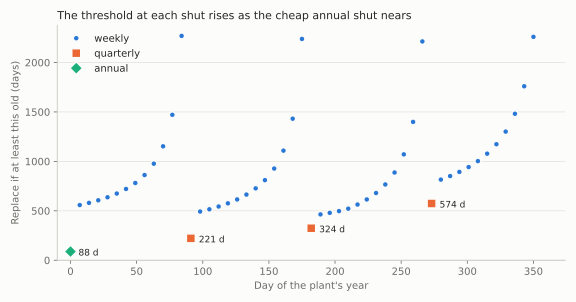

# Maintenance policies

!!! tip "Learning this for the first time?"
    This page is the reference. The ideas behind it are taught step by step,
    with worked examples and exercises, in [Lesson
    8](../learn/maintenance.md) (maintaining on purpose).

Two component-level classes price preventive maintenance. They sit at the two
ends of how effective a repair is:

- [`NonRepairable`][repyability.NonRepairable]: the unit is **replaced** on
  failure, as good as new, so every cycle is a statistical renewal. It is
  also the component model a `RepairableRBD` uses internally.
- [`Repairable`][repyability.Repairable]: failures are **repaired** in a way
  that restores the unit only partly (imperfect repair) or not at all
  (minimal repair, "as bad as old"), and the unit is periodically
  **overhauled or replaced** to as good as new. A `Repairable` is a
  standalone tool, not an RBD node; in a `RepairableRBD` a component's
  `"repair"` simulates the same imperfect repair (see [Repairable
  systems](repairable.md#imperfect-repair)).

Fitting the lifetime or recurrence models is surpyval's job; these classes
take fitted models. Theory: [Concepts](../concepts.md#maintenance-models).

## Age replacement (`NonRepairable`)

Replace the unit at age `t` (a planned replacement costing `cp`) or on
failure (unplanned, costing `cu > cp`), whichever comes first. The long-run
cost rate is the expected cost of a cycle over its expected length,

```
cost_rate(t) = (cp · R(t) + cu · F(t)) / ∫₀ᵗ R(u) du
```

and `find_optimal_replacement()` minimises it:

```python
import surpyval as surv
from repyability import NonRepairable

bearing = NonRepairable(surv.Weibull.from_params([1000, 2.5]))
bearing.set_costs_planned_and_unplanned(1, 5)   # cp, cu

bearing.find_optimal_replacement()      # -> 493.05   replace at age 493
policy = bearing.optimal_replacement_policy()
policy.interval                         # -> 493.05
policy.cost_rate                        # -> 0.003462   cost per unit time
bearing.avg_replacement_time(493.05)    # -> 470.15  ∫₀ᵗ R(u) du, the mean cycle length
```

For an exponential lifetime, or a Weibull with shape 1 or less, the unit
does not wear out and preventive replacement never pays: the interval is
`inf` and the cost rate is the run-to-failure rate `cu / MTTF`. The same goes
for any lifetime whose best replacement age is no cheaper than running to
failure (a Gamma with shape below 1, say, or a Weibull of shape 1 or less with
zero-inflation or an offset). When some units never fail (a limited failure
population), running to failure costs nothing in the long run, since those
units are kept, so the interval is `inf` at a cost rate of 0.

An offset (a failure-free period) can make replacement pay even without
wear-out: no unit fails before the offset, so replacing just as it ends
avoids the failures that follow.

```python
dormant = NonRepairable(surv.Weibull.from_params([10, 0.5], gamma=1000))
dormant.set_costs_planned_and_unplanned(1, 5)
dormant.find_optimal_replacement()                 # -> 1000.0   at the offset
dormant.optimal_replacement_policy().cost_rate     # -> 0.001    cp / 1000
```

```python
steady = NonRepairable(surv.Exponential.from_params([0.001]))
steady.set_costs_planned_and_unplanned(1, 5)
steady.optimal_replacement_policy().cost_rate   # -> 0.005   = 5 / 1000
```

`set_costs_planned_and_unplanned` raises `ValueError` unless both costs are
finite, `cp` is not negative and `cp < cu`. Set the costs before asking for a
cost rate or a policy: without them `cost_rate`, `find_optimal_replacement()`
and `optimal_replacement_policy()` raise `ValueError` (except that
`find_optimal_replacement()` returns `inf` without them in the cases above).

A non-parametric lifetime (a Kaplan–Meier fit, say) works too, for a unit on
its own (a diagram refuses one: see [Building an RBD](building.md)). Its survival
function is taken as linear between the estimate's time points, from 1 at age
0, and held at its last value beyond them; the cost rate is then exact, and
the search covers ages up to the last time point, since the estimate says
nothing about later ones.

### As a repairable component

The second argument of `NonRepairable` is the time to replace (repair) the
unit; it defaults to zero (an instant swap). With it, the unit has a
long-run availability and failure frequency, which is how a `RepairableRBD`
uses it:

```python
pump = NonRepairable(
    surv.Weibull.from_params([1000, 2.5]),
    surv.Exponential.from_params([1 / 24]),   # mean 24 h to replace
)
pump.mean_availability()     # -> 0.9737   MTTF / (MTTF + MTTR)
pump.mean_unavailability()   # -> 0.02634
pump.failure_frequency()     # -> 0.001097   1 / (MTTF + MTTR)
```

`reset()` and `next_event()` are the event interface a `RepairableRBD`
simulation calls: `next_event()` alternates between drawing a time to failure
from `reliability` (returned with `False`) and a time to repair from
`time_to_replace` (returned with `True`), and `reset()` starts again with a
failure.

To price an age- or block-replacement policy for a component in its system
(where a planned stop may or may not halt production), give the component a
`"preventive"` schedule in a `RepairableRBD`: see
[Costs](system-maintenance.md#preventive-maintenance).

## Replacement over a calendar of shuts (`NonRepairable`)

Age replacement has one planned price at every moment. In a plant, the price
depends on the date: replacing a bearing in the annual shut costs little, in a
quarterly shut more, at a weekly stop more again, on any other day more still
(or it is not allowed), and at a failure most of all.
[`optimal_calendar_policy`][repyability.NonRepairable.optimal_calendar_policy]
finds the long-run optimal policy over such a calendar
(opportunity-based age replacement, after Dekker et al.). The state is the
date and the part's age, and the policy is a **threshold for each date**:
replace the part if it is at least `a*(t)` old.

Times are numbers in the life model's unit (days here), from 0: turning dates
into them is Reliafy's.

```python
import surpyval as surv
from repyability import Calendar, NonRepairable, Opportunity

bearing = NonRepairable(surv.Weibull.from_params([1000.0, 2.5]))
plant = Calendar(
    [
        Opportunity("weekly", 3.0, period=7.0),
        Opportunity("quarterly", 2.0, period=91.0),
        Opportunity("annual", 1.0, period=364.0),
    ],
    failure=20.0,      # by default the part's unplanned_cost
    anytime=4.0,       # any other day; None: not allowed; by default its planned_cost
)
policy = bearing.optimal_calendar_policy(plant)

policy.cost_rate             # -> 0.006943   a day (2.53 a year)
policy.replacement_rates     # a day; a year:  annual 0.962, failure 0.078,
                             #   weekly, quarterly and any day 0
policy.cost_rates            # a day; a year:  annual 0.962, failure 1.566
policy.schedule(kinds=("quarterly", "annual"))
# -> [(0.0,   'annual',    88.375, 0.962),   (time, kind, threshold, chance)
#     (91.0,  'quarterly', 221.375, 0.0),
#     (182.0, 'quarterly', 323.75, 0.0),
#     (273.0, 'quarterly', 574.0, 0.0)]
policy.next_replacement(age=60.0, now=364.0)
# -> PlannedReplacement(time=728.0, kind='annual', price=1.0)
```

An [`Opportunity`][repyability.Opportunity] repeats every `period` from its
`offset`, or falls on given `dates`.

- **What the policy does, and costs.** `replacement_rates` and `cost_rates`
  give, by kind, the replacements and the cost a unit of time in the long
  run; the costs sum to `cost_rate`. Here the annual shut does all the
  planned work: 0.96 replacements a year at 1, with 0.08 failures a year at
  20, and no other kind is ever used.
- **Each shut's threshold, and whether it is used.** `schedule()` lists each
  opportunity of a cycle as `(time, kind, threshold, chance)`: replace the
  unit there if it is at least `threshold` old, which happens with `chance`
  in the long run. The threshold at a shut depends on how far the next
  cheaper one is (the quarterly shut a quarter before the annual waits for a
  unit of 574 days, the one three quarters before it for one of 221), but at
  these prices the annual shut replaces units before they reach any of them,
  so each quarterly shut's chance is 0.
- **The unit in service.** `next_replacement(age, now)` says when it will be
  replaced, if it does not fail first: a unit 60 days old at the annual shut
  is younger than its threshold, about 88 days, so it is kept to the next
  one.



The chart is drawn by `scripts/calendar_policy_chart.py`. The quarterly and
annual thresholds, with what the simple policies cost over ten years of the
plant ([`calendar_policy_cost`][repyability.NonRepairable.calendar_policy_cost]
prices a rule given as the age from which each kind of replacement replaces):

| Policy | Rule | Cost over 10 years |
|---|---|---|
| **Optimal** | annual from 88 d; quarterly from 221, 324, 574 d; weekly as charted | **25.27** |
| Every annual shut | `{"annual": 0.0}` | 25.48 |
| Age replacement on any day | `{"anytime": 493.0}` (the textbook interval at 4 and 20) | 50.41 |
| Run to failure | `{}` | 82.05 |

### How it is worked out

`method="auto"` (the default) chooses among these:

- **`"dp"`**: dynamic programming on a grid (its step about the mean life
  over 1,000, put on the opportunities' own times). Over a periodic
  calendar whose cycle (the least common multiple of its periods) has at
  most 20,000 steps, relative value iteration gives the cost rate exactly for
  the grid; a failure renews half a step later on average, so the grid's
  error is second order in the step. With no opportunities and a planned
  price on any day, it is age replacement: threshold 493 days, 0.0034620 a
  day, against the textbook 493.05 and 0.0034620.
- **`"integration"`**: between opportunities in continuous time, on
  quadrature nodes (32 a gap); only with no replacement on any day. It agrees
  with `"dp"` as the step shrinks.
- **`"sampling"`**: for a cycle too long to sweep (co-prime periods of 7, 93,
  400 and 1,301 days repeat every 928,000 years). The cost rate is the mean
  over `mc_samples` sampled times of the cycle of a window's rate, each window
  an exact solve, with its standard error (`cost_rate_se`); the threshold at a
  time is a solve over a window from it, deterministic.

`policy.method` and `policy.basis` (`"exact"`, `"differenced"` or
`"sampled"`) say which was used.

**How exact it is.** The grid's step is not an argument: it is a numerical
setting, sized from the life and put on the shuts' times (here 0.875 days),
not a choice of when decisions are made, which the calendar says by its
opportunities. On the grid the cost rate is exact for decisions at its
times, and within about the square of the step of deciding at any moment:
for this plant 2.5272582 a year, against 2.5272583 on a grid four times as
fine. With no replacement on any day, `method="integration"` works between
the shuts in continuous time, exact but for its quadrature (2.5272576 a
year here). A plan of given dates is extended past its
last date by `tail`: `"repeat"` (repeat it) or `"anytime"` (only the
replacement on any day). Both are solved, and `policy.determined_until` is the
first time at which the two differ: the policy before it does not depend on
what comes after the plan. If at some time the ages that replace are not all
those from the youngest (a life whose hazard falls), the policy says so
(`threshold_only` is False) and warns.

## Overhaul under minimal repair (`Repairable`)

Each failure is minimally repaired at cost `cr`; every `t` the unit is
overhauled to as good as new at cost `co > cr`. With `Λ(t)` the expected
number of failures by `t` (the cumulative intensity), the long-run cost rate
is the Barlow–Hunter policy,

```
cost_rate(t) = (cr · Λ(t) + co) / t
```

For a power-law (Crow–AMSAA) process `Λ(t)` is analytic:

```python
from surpyval.recurrent import CrowAMSAA
from repyability import Repairable

gearbox = Repairable(CrowAMSAA.from_params([1500, 1.5]))
gearbox.set_repair_and_overhaul_costs(100, 10_000)   # cr, co

gearbox.is_simulated                    # False: E[N(t)] is analytic
gearbox.find_optimal_overhaul_interval()   # -> 51299.3
gearbox.optimal_overhaul_policy().cost_rate   # -> 0.5848
gearbox.cost(5000)                      # -> 10608.6   the cost of one 5000-hour cycle
gearbox.cost_rate(5000)                 # -> 2.122     overhauling every 5000 hours instead
```

A finite optimum needs wear-out (Crow–AMSAA `beta > 1`). With `beta <= 1`
repairs never become more frequent, overhauls never pay, and the interval is
`inf` with the cost rate of the repairs alone:

```python
steady_gearbox = Repairable(CrowAMSAA.from_params([1500, 0.9]))
steady_gearbox.set_repair_and_overhaul_costs(100, 10_000)
steady_gearbox.optimal_overhaul_policy().interval   # inf
```

## Imperfect repair (`Repairable`)

Most repairs sit between the two extremes: each one turns the unit's
virtual age back part of the way. Give `Repairable` a surpyval
`GeneralizedRenewal` model (Kijima I or II, restoration factor `q` between 0
for perfect repair and 1 for minimal repair) and the same policies apply.
`E[N(t)]` then has no closed form and is estimated by simulation, so pass a
`seed` for a reproducible answer and `mc_samples` to trade speed for
precision (default 1000). The simulated numbers below (marked `~>`) vary a
little with the seed and with surpyval's simulator; the cost rate is flat
near its minimum, so the interval found varies more than the cost rate:

```python
from surpyval.recurrent import GeneralizedRenewal

model = GeneralizedRenewal.fit_from_parameters(
    [1500, 2.0], q=0.4, kijima="i", dist=surv.Weibull
)
compressor = Repairable(model)
compressor.set_repair_and_overhaul_costs(100, 1000)

compressor.is_simulated   # True
overhaul = compressor.optimal_overhaul_policy(seed=0, mc_samples=200)
overhaul.interval         # ~> 7600   between 7,400 and 7,900
overhaul.cost_rate        # ~> 0.294
```

`max_interval` bounds the search (by default 15 times the mean of the
baseline lifetime). If surpyval's simulator reports that it stopped
resolving failures before the horizon (as it can close to minimal repair,
`q` near 1, where the unit's virtual age reaches ages at which the survival
underflows double precision), the search shortens its horizon to what the
simulation can resolve, so near-minimal repair needs no special handling.
The simulated search never returns `inf`:
if the cost rate is still falling at the horizon (overhauls never pay, or
the optimum lies beyond it), it returns the horizon with a warning that says
whether a larger `max_interval` could help. The optimum grows as repairs
become more effective.

### Replace at the N-th failure

Instead of renewing at a fixed age, repair each failure and replace the unit
at its N-th failure. The cost rate is `(cr · (N − 1) + co) / E[T_N]`, with
`E[T_N]` the expected time to the N-th failure:

```python
limit = compressor.optimal_failure_limit_policy(seed=0, mc_samples=500)
limit.failure_count   # ~> 14   replace at the 13th or 14th failure
limit.cost_rate       # ~> 0.285
compressor.find_optimal_replacement_failure_count(seed=0, mc_samples=500)   # ~> 14
compressor.expected_time_to_nth_failure(5, seed=0, mc_samples=500)   # ~> 4360
```

The result is a [`FailureLimitPolicy`][repyability.FailureLimitPolicy].
`max_failures` bounds the search (by default 30); if the optimum equals the
bound, raise it. The cost rate is usually flat near its minimum, so the
optimal count can move by several failures with the seed or `mc_samples`
while the cost rate barely changes: read it as a region, and compare cost
rates. These methods need a simulation-backed (imperfect-repair) model and
raise `ValueError` otherwise.

For the minimal-repair limit (`q = 1`, a power-law process), `E[T_n]` is exact
and needs no simulation:

```python
from repyability import minimal_repair_time_to_nth_failure

minimal_repair_time_to_nth_failure(alpha=1500, beta=2.0, n=5)   # -> 3271.4
```

It is `alpha · Γ(n + 1/beta) / Γ(n)`.

## Results

Both policy types are small typed results:
[`MaintenancePolicy`][repyability.MaintenancePolicy] (`interval`,
`cost_rate`) and [`FailureLimitPolicy`][repyability.FailureLimitPolicy]
(`failure_count`, `cost_rate`). A calendar's policy is a
[`CalendarPolicy`][repyability.CalendarPolicy] (`cost_rate`,
`replacement_rates`, `cost_rates`, `schedule()`, `next_replacement()`). Costs are per event and undiscounted.
