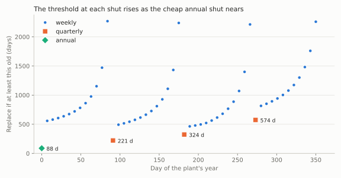

# Maintenance policies

!!! tip "Learning this for the first time?"
    This page is the reference. The ideas behind it are taught step by step,
    with worked examples and exercises, in [Lesson
    8](../learn/maintenance.md) (maintaining on purpose).

Two component-level classes price preventive maintenance. They sit at the two
ends of how effective a repair is:

- [`NonRepairable`][repyability.NonRepairable]: the unit is **replaced** on
  failure, as good as new, so every cycle is a statistical renewal. It is
  also the component model a `RepairableRBD` uses internally.
- [`Repairable`][repyability.Repairable]: failures are **repaired** in a way
  that restores the unit only partly (imperfect repair) or not at all
  (minimal repair, "as bad as old"), and the unit is periodically
  **overhauled or replaced** to as good as new. A `Repairable` is a
  standalone tool, not an RBD node; in a `RepairableRBD` a component's
  `"repair"` simulates the same imperfect repair (see [Repairable
  systems](repairable.md#imperfect-repair)).

Fitting the lifetime or recurrence models is surpyval's job; these classes
take fitted models. Theory: [Concepts](../concepts.md#maintenance-models).

## Age replacement (`NonRepairable`)

Replace the unit at age `t` (a planned replacement costing `cp`) or on
failure (unplanned, costing `cu > cp`), whichever comes first. The long-run
cost rate is the expected cost of a cycle over its expected length,

```
cost_rate(t) = (cp · R(t) + cu · F(t)) / ∫₀ᵗ R(u) du
```

and `find_optimal_replacement()` minimises it:

```python
import surpyval as surv
from repyability import NonRepairable

bearing = NonRepairable(surv.Weibull.from_params([1000, 2.5]))
bearing.set_costs_planned_and_unplanned(1, 5)   # cp, cu

bearing.find_optimal_replacement()      # -> 493.05   replace at age 493
policy = bearing.optimal_replacement_policy()
policy.interval                         # -> 493.05
policy.cost_rate                        # -> 0.003462   cost per unit time
bearing.avg_replacement_time(493.05)    # -> 470.15  ∫₀ᵗ R(u) du, the mean cycle length
```

For an exponential lifetime, or a Weibull with shape 1 or less, the unit
does not wear out and preventive replacement never pays: the interval is
`inf` and the cost rate is the run-to-failure rate `cu / MTTF`. The same goes
for any lifetime whose best replacement age is no cheaper than running to
failure (a Gamma with shape below 1, say, or a Weibull of shape 1 or less with
zero-inflation or an offset). When some units never fail (a limited failure
population), running to failure costs nothing in the long run, since those
units are kept, so the interval is `inf` at a cost rate of 0.

An offset (a failure-free period) can make replacement pay even without
wear-out: no unit fails before the offset, so replacing just as it ends
avoids the failures that follow.

```python
dormant = NonRepairable(surv.Weibull.from_params([10, 0.5], gamma=1000))
dormant.set_costs_planned_and_unplanned(1, 5)
dormant.find_optimal_replacement()                 # -> 1000.0   at the offset
dormant.optimal_replacement_policy().cost_rate     # -> 0.001    cp / 1000
```

```python
steady = NonRepairable(surv.Exponential.from_params([0.001]))
steady.set_costs_planned_and_unplanned(1, 5)
steady.optimal_replacement_policy().cost_rate   # -> 0.005   = 5 / 1000
```

`set_costs_planned_and_unplanned` raises `ValueError` unless both costs are
finite, `cp` is not negative and `cp < cu`. Set the costs before asking for a
cost rate or a policy: without them `cost_rate`, `find_optimal_replacement()`
and `optimal_replacement_policy()` raise `ValueError` (except that
`find_optimal_replacement()` returns `inf` without them in the cases above).

A non-parametric lifetime (a Kaplan–Meier fit, say) works too, for a unit on
its own (a diagram refuses one: see [Building an RBD](building.md)). Its survival
function is taken as linear between the estimate's time points, from 1 at age
0, and held at its last value beyond them; the cost rate is then exact, and
the search covers ages up to the last time point, since the estimate says
nothing about later ones.

### As a repairable component

The second argument of `NonRepairable` is the time to replace (repair) the
unit; it defaults to zero (an instant swap). With it, the unit has a
long-run availability and failure frequency, which is how a `RepairableRBD`
uses it:

```python
pump = NonRepairable(
    surv.Weibull.from_params([1000, 2.5]),
    surv.Exponential.from_params([1 / 24]),   # mean 24 h to replace
)
pump.mean_availability()     # -> 0.9737   MTTF / (MTTF + MTTR)
pump.mean_unavailability()   # -> 0.02634
pump.failure_frequency()     # -> 0.001097   1 / (MTTF + MTTR)
```

`reset()` and `next_event()` are the event interface a `RepairableRBD`
simulation calls: `next_event()` alternates between drawing a time to failure
from `reliability` (returned with `False`) and a time to repair from
`time_to_replace` (returned with `True`), and `reset()` starts again with a
failure.

To price an age- or block-replacement policy for a component in its system
(where a planned stop may or may not halt production), give the component a
`"preventive"` schedule in a `RepairableRBD`: see
[Costs](system-maintenance.md#preventive-maintenance).

## Replacement over a calendar of shuts (`NonRepairable`)

Age replacement has one planned price at every moment. In a plant, the price
depends on the date: replacing a bearing in the annual shut costs little, in a
quarterly shut more, at a weekly stop more again, on any other day more still
(or it is not allowed), and at a failure most of all.
[`optimal_opportunity_policy`][repyability.NonRepairable.optimal_opportunity_policy]
finds the long-run optimal policy over such a calendar
(opportunity-based age replacement, after Dekker et al.). The state is the
date and the part's age, and the policy is a **threshold for each date**:
replace the part if it is at least `a*(t)` old.

The opportunities ([`Opportunities`][repyability.Opportunities] of
[`Opportunity`][repyability.Opportunity]) say when; the **prices come with
the part**, as one record of shuts serves every part: `planned_cost` on any
other day, `unplanned_cost` at a failure, `opportunity_cost` at an
opportunity (by default its `planned_cost`, as any other day), and
`opportunity_costs` for particular ones, by name or by the `Opportunity`
itself. Here, times are numbers in the life model's unit (days), from 0;
the same works on real dates (below). Which dates a rule gives is
[`repyability.schedule`](schedule.md)'s.

```python
import surpyval as surv
from repyability import NonRepairable, Opportunities, Opportunity

plant = Opportunities(
    [
        Opportunity("weekly", period=7.0),
        Opportunity("quarterly", period=91.0),
        Opportunity("annual", period=364.0),
    ],
    any_day=True,      # a planned replacement on any other day (the default)
)
bearing = NonRepairable(
    surv.Weibull.from_params([1000.0, 2.5]),
    planned_cost=4.0,          # any other day
    unplanned_cost=20.0,       # a failure
    opportunity_costs={"weekly": 3.0, "quarterly": 2.0, "annual": 1.0},
)
policy = bearing.optimal_opportunity_policy(plant)
policy.prices.price("annual"), policy.prices.row("annual").source   # -> (1.0, 'override')

policy.cost_rate             # -> 0.006943   a day (2.53 a year)
policy.replacement_rates     # a day; a year:  annual 0.962, failure 0.078,
                             #   weekly, quarterly and any day 0
policy.cost_rates            # a day; a year:  annual 0.962, failure 1.566
policy.schedule(kinds=("quarterly", "annual"))
# -> [(0.0,   'annual',    88.375, 0.962),   (time, kind, threshold, chance)
#     (91.0,  'quarterly', 221.375, 0.0),
#     (182.0, 'quarterly', 323.75, 0.0),
#     (273.0, 'quarterly', 574.0, 0.0)]
policy.next_replacement(age=60.0, now=364.0)
# -> PlannedReplacement(time=728.0, kind='annual', price=1.0)
```

An [`Opportunity`][repyability.Opportunity] in model time repeats every
`period` from its `offset`, or falls on given `dates`. The policy's
`prices` ([`OpportunityPrices`][repyability.OpportunityPrices]) list the
price each opportunity was given and where it came from (an override, the
part's `opportunity_cost`, or its `planned_cost`), and any opportunity not
used: one shorter than the part's `job_duration` ("the 6 h job doesn't fit
in the 4 h stop"), or, with `where=`, one that does not take that label
down. (`Calendar`, with the prices on the opportunities, is deprecated; it
still works, and gives the same numbers.)

- **What the policy does, and costs.** `replacement_rates` and `cost_rates`
  give, by kind, the replacements and the cost a unit of time in the long
  run; the costs sum to `cost_rate`. Here the annual shut does all the
  planned work: 0.96 replacements a year at 1, with 0.08 failures a year at
  20, and no other kind is ever used.
- **Each shut's threshold, and whether it is used.** `schedule()` lists each
  opportunity of a cycle as `(time, kind, threshold, chance)`: replace the
  unit there if it is at least `threshold` old, which happens with `chance`
  in the long run. The threshold at a shut depends on how far the next
  cheaper one is (the quarterly shut a quarter before the annual waits for a
  unit of 574 days, the one three quarters before it for one of 221), but at
  these prices the annual shut replaces units before they reach any of them,
  so each quarterly shut's chance is 0.
- **The unit in service.** `next_replacement(age, now)` says when it will be
  replaced, if it does not fail first: a unit 60 days old at the annual shut
  is younger than its threshold, about 88 days, so it is kept to the next
  one.



The chart is drawn by `scripts/calendar_policy_chart.py`. The quarterly and
annual thresholds, with what the simple policies cost over ten years of the
plant ([`opportunity_policy_cost`][repyability.NonRepairable.opportunity_policy_cost]
prices a rule given as the age from which each kind of replacement replaces):

| Policy | Rule | Cost over 10 years |
|---|---|---|
| **Optimal** | annual from 88 d; quarterly from 221, 324, 574 d; weekly as charted | **25.27** |
| Every annual shut | `{"annual": 0.0}` | 25.48 |
| Age replacement on any day | `{"anytime": 493.0}` (the textbook interval at 4 and 20) | 50.41 |
| Run to failure | `{}` | 82.05 |

### How it is worked out

`method="auto"` (the default) chooses among these:

- **`"dp"`**: dynamic programming on a grid (its step about the mean life
  over 1,000, put on the opportunities' own times). Over a periodic
  calendar whose cycle (the least common multiple of its periods) has at
  most 20,000 steps, relative value iteration gives the cost rate exactly for
  the grid; a failure renews half a step later on average, so the grid's
  error is second order in the step. With no opportunities and a planned
  price on any day, it is age replacement: threshold 493 days, 0.0034620 a
  day, against the textbook 493.05 and 0.0034620.
- **`"integration"`**: between opportunities in continuous time, on
  quadrature nodes (32 a gap); only with no replacement on any day. It agrees
  with `"dp"` as the step shrinks.
- **`"sampling"`**: for a cycle too long to sweep (co-prime periods of 7, 93,
  400 and 1,301 days repeat every 928,000 years). The cost rate is the mean
  over `mc_samples` sampled times of the cycle of a window's rate, each window
  an exact solve, with its standard error (`cost_rate_se`); the threshold at a
  time is a solve over a window from it, deterministic. Each window takes a
  second or more, so `mc_samples` (64 by default) sets the cost.
  `"auto"` still falls to sampling there, with a `FutureWarning`: from
  0.21 it refuses, naming a ready `horizon=` (the lowest total cost to
  then, worked out exactly) and `method="sampling"`. A sampled policy's rates by kind
  (`replacement_rates`, `cost_rates`) and the schedule's chances are
  estimates from a new unit run in, with no standard error: only the cost
  rate has one, and the rates by kind move with the seed (by some 10% at
  8 samples).

`policy.method` and `policy.basis` (`"exact"`, `"differenced"` or
`"sampled"`) say which was used.

**How exact it is.** The grid's step is not an argument: it is a numerical
setting, sized from the life and put on the shuts' periods (here 0.875 days),
not a choice of when decisions are made, which the calendar says by its
opportunities. A periodic calendar keeps its period on the grid whatever
its offsets: an offset or date off the grid (a shut 0.1234 days, three
hours, into the day, as dates turned into model time give) is laid at the
grid time nearest it, within half a step, with a warning, and the policy
is the aligned calendar's. On the grid the cost rate is exact for decisions at its
times, and within about the square of the step of deciding at any moment:
for this plant 2.5272582 a year, against 2.5272583 on a grid four times as
fine. With no replacement on any day, `method="integration"` works between
the shuts in continuous time, exact but for its quadrature (2.5272576 a
year here). A plan of given dates is extended past its
last date by `tail`: `"repeat"` (repeat it) or `"anytime"` (only the
replacement on any day). Both are solved, and `policy.determined_until` is the
first time at which the two differ: the policy before it does not depend on
what comes after the plan. If at some time the ages that replace are not all
those from the youngest (a life whose hazard falls), the policy says so
(`threshold_only` is False) and warns.

The policy prices a part alone. Given to a `RepairableRBD` component (see
[Replacement on a calendar policy](system-maintenance.md#replacement-on-a-calendar-policy)),
it is followed as worked out, in a maintenance group too, whose stops are
then chances to renew the part that the policy did not plan for: it is not
re-optimised for them.

## Shutdown policies on real dates

A site keeps its shuts as rules on dates ("every Saturday", "the first
Tuesday of November"), fixed dates (turnarounds), plain periods or a use
("every 15,000 km"). [`Opportunities`][repyability.Opportunities] holds them as **one record**:
each [`Opportunity`][repyability.Opportunity] with when it happens, how long
it lasts and what it takes down, whether a planned replacement may be made
on any other day, and the site's time zone. Each part brings its prices, as
in model time. Given opportunities on real dates,
[`optimal_opportunity_policy`][repyability.NonRepairable.optimal_opportunity_policy]
returns a [`ShutdownPolicy`][repyability.ShutdownPolicy] with the answer on
the real dates and how it was worked out, by one of the routes it always
names:

| Route | When | You give | It says |
|---|---|---|---|
| **exact** | The shuts repeat in the part's own clock on a short cycle (about a minute's work or less) | nothing | "Exact long-run average: $X a year." |
| **long cycle** | They repeat, but only after a long cycle | `method="exact"` (slow, said beforehand) or `"sampling"` (with its ±) | "Estimated long-run average: $X a year ± $Y" |
| **averaged** | They don't repeat (rules by month or year, a use on another meter) | `method="averaged"` | "Long-run average, assuming shuts fall evenly within their usual gaps (...)" |
| **horizon** | Any site; never refused | `horizon=` and `discount=` (0 for the plain total) | "Lowest net present cost to ... at 7% a year: $X (an equivalent annual cost of $Y a year). Decisions from about ... depend on where the horizon ends." |
| **dated then long run** | Some shuts are on fixed dates (or you give `dated_until=`) | nothing more, or what the recurring shuts' long run needs (above) | "Dated window to 9 Sep 2028, then the long-run average: $X a year. ..." |

**Fixed dates are never averaged.** Without a horizon, a site with fixed
dates takes a dated window from now to the last of them (or to
`dated_until=`, a later day, for a shut schedule planned further ahead).
Inside the window every shut is on its real dates, the recurring kinds'
too, so fixed dates and rules combine freely. After it only the recurring
shuts remain, and their long-run average cost a year, by the route they
take on their own, values everything beyond: no horizon or discount is
needed. The rule comes in two phases, each fixed date with its own
threshold (`rule.dated`); `cost` is the long run's a year and
`dated_cost` the expected cost to the window's end. A kind given
`then_every="4 years"` keeps its known dates exactly and then recurs at
that gap from the last, as one of the recurring shuts; the result says
so. Undiscounted, the long run's cost a year adds the same to every
choice in the window, so the window's decisions turn on what a part of
each age is worth carrying past its end: worked out by running on over
the recurring shuts' real dates until the window's decisions no longer
change.

Nothing is chosen silently: where a choice is needed, the call is refused
with what to choose, a ready horizon among it, worked out from the
inputs (with a discount, the day past which costs are discounted to under
one part in a billion: `horizon='2333-11-16'` at 7% from 16 Nov 2026; with
none, the full cycle and three of the part's life spans). With `discount=`
and no horizon, the answer is the exact discounted long run wherever the
shuts repeat, and a given rule (`opportunity_policy_cost`, `compare()`)
is priced the same way; shuts that drift on real dates, a duty plan or a
long cycle refuse with the ready horizon. In model time the same holds:
`horizon=` is a number in the calendar's own time, with `discount_rate=`.
And
[`Opportunities.route`][repyability.Opportunities.route] says beforehand which
route, which solver (`"closed form"`, `"grid"`, `"quadrature"` or
`"sampling"`) and about how long. Routes 1-3 give a cost a year, the horizon
a net present cost (`measure`), so the two are never compared by accident.
`failure_timing="half_step"` (the default) works on a grid, a failure's
replacement counted half a step old; `"exact"` integrates between the shuts
in continuous time (a `SlowSolverWarning` where that takes over about 5 s;
it does not price a replacement on any other day). The averaged route's
formula is opportunity-based age replacement in the sense of Dekker &
Dijkstra (1992, *Naval Research Logistics* 39(2):175-190) and Dekker &
Smeitink (1991, *European Journal of Operational Research* 53(1):46-63).

**Example 1: the classic, no dates at all.** Nothing here changes it:

```python
import surpyval as surv
from repyability import NonRepairable

bearing = NonRepairable(surv.Weibull.from_params([1000, 2.5]))   # life in days
bearing.set_costs_planned_and_unplanned(1, 5)
policy = bearing.optimal_replacement_policy()
round(policy.interval, 2)      # -> 493.05
round(policy.cost_rate, 6)     # -> 0.003462   a day
```

**Example 2: replacement only at a stop every 30 days.** `every=` is a
plain period (a fixed length of time), so the stops repeat in the part's
clock and the route is exact:

The bearing has no `opportunity_cost`, so a stop is priced as any other
day, at its `planned_cost` of 1:

```python
from repyability import Opportunities, Opportunity

site = Opportunities([Opportunity("monthly stop", every="30 days")], any_day=False)
best = bearing.optimal_opportunity_policy(site, unit="days")   # the life's unit
best.route                     # 'exact'
best.rule.text                 # 'Replace at a monthly stop if older than 479.1 days; never on any other day (the site allows none).'
round(best.cost, 3)            # -> 1.265   a year
best.measure                   # 'cost per year'
```

**Example 3: a fixed plant.** Weekday shifts in Brisbane, a weekly stop on
Saturday, a quarterly shut, the first Tuesday of November, and two
turnarounds. The bearing's life is in operating hours, so the plan turns
dates into its clock:

```python
from repyability.schedule import DutyPlan, Recurrence, Shifts

plant = Opportunities(
    [
        Opportunity("weekly stop", Recurrence.weekly("Sat"), duration="8h"),
        Opportunity("quarterly shut", Recurrence.monthly(weekday="Sunday", nth=1, every=3,
                                                         anchor="2026-12-06"),
                    duration="1d"),
        Opportunity("annual shut", Recurrence.yearly(month="November", weekday="Tuesday", nth=1),
                    duration="3d"),
        Opportunity("turnaround", dates=["2027-03-03", "2028-09-09"], duration="14d"),
    ],
    time_zone="Australia/Brisbane",
)
pump_bearing = NonRepairable(
    surv.Weibull.from_params([20_000, 2.5]),
    planned_cost=4.0, unplanned_cost=40.0,
    opportunity_costs={"weekly stop": 3.0, "quarterly shut": 2.0,
                       "annual shut": 1.0, "turnaround": 0.5},
)
shifts = DutyPlan(Shifts("Mon-Fri", "06:00", "22:00"), time_zone="Australia/Brisbane")
plant.route(pump_bearing, plan=shifts, now="2026-11-16", unit="hours").route   # 'horizon_or_averaged'
```

The route check explains: the turnarounds are used as dated to 9 Sep 2028;
after that the quarterly shut falls 84 to 98 days apart and the annual
shut 364 or 371, so the recurring shuts' long run needs a choice. With
`method="averaged"` it spreads each recurring kind evenly within its usual
gaps (the turnarounds are never averaged):

```python
when = dict(plan=shifts, now="2026-11-16", unit="hours", age=3100)
best = pump_bearing.optimal_opportunity_policy(plant, method="averaged", **when)
best.route                         # 'dated_then_long_run'
best.solver, best.long_run_route   # ('grid', 'averaged')
round(best.cost, 2)                # -> 1.9   a year, after the window
round(best.dated_cost, 2)          # -> 3.31  expected to 9 Sep 2028
best.route_text.split(" Expected")[0]   # "Dated window to 9 Sep 2028, then the long-run average: $1.90 a year. Using the turnarounds on 3 Mar 2027 and 9 Sep 2028 as dated, then the recurring shuts' long-run average after 9 Sep 2028."
best.rule.dated                    # [('2027-03-03', 'turnaround', 1543.8...), ('2028-09-09', 'turnaround', 798.5...)]
str(best.next_replacement)         # 'At the turnaround, 3 Mar 2027, part 4,332 old'
[k for d, k, a in best.schedule("2031-12-31")]
# ['annual shut', 'turnaround', 'annual shut', 'annual shut', 'annual shut']   a bearing fitted today
```

`best.rule.text` gives both phases: "To 9 Sep 2028: replace at the
turnaround on 3 Mar 2027 if older than 1,544 hours; at the turnaround on
9 Sep 2028 if older than 798.5 hours; ... After 9 Sep 2028: Replace at an
annual shut if older than 1,949 hours; ...". The long-run figure is the
recurring shuts' own: the same site without the turnarounds gives $1.90 a
year too. Were the turnarounds to go on every four years,
`Opportunity("turnaround", dates=[...], then_every="4 years", ...)` says so,
and the result states "turnarounds after 9 Sep 2028 assumed every 4 years
(your setting)". A horizon uses every date to its end and needs a
discount:

```python
ten_years = pump_bearing.optimal_opportunity_policy(
    plant, horizon="2036-11-16", discount=0.07, **when
)
ten_years.measure                  # 'net present cost'
round(ten_years.cost, 2)           # -> 12.30
str(ten_years.next_replacement)    # 'At the turnaround, 3 Mar 2027, part 4,332 old'
ten_years.settings["decisions_depend_from"] is not None   # True
```

**Example 4: a truck serviced every 15,000 km.** A shut can recur by use,
with a calendar limit, whichever comes first. The gearbox's life is in km,
the services are in km, so they repeat exactly in its clock, whatever the
duty: the duty only turns the answers into dates.

```python
from repyability.schedule import Rate, Usage

gearbox = NonRepairable(
    surv.Weibull.from_params([180_000, 2.2]),
    planned_cost=14_000, unplanned_cost=40_000, opportunity_cost=9_000,
)
truck = DutyPlan(Rate(400, per="day", meter="km"))
depot = Opportunities(
    [Opportunity("service", every=Usage(15_000, "km"), also_every="6 months",
                 duration="6h")],
)
road = dict(plan=truck, now="2026-11-16", readings={"km": 212_000}, unit="km")
depot.route(gearbox, **road).route      # 'exact'
service = gearbox.optimal_opportunity_policy(depot, age=28_000, **road)
service.rule.text                       # 'Replace at a service if older than 89,000 km; on any other day once older than 243,143 km.'
str(service.next_replacement)           # 'At the service, 17 May 2027, part 101,000 old'
service.schedule("2027-12-31")[0]       # ('2027-07-31', 'service', 103000.0)   a gearbox fitted today
```

**Example 5: an aircraft on a daily plan.** Four sectors a day; the brakes'
life is in landings, the A-check is every 600 flight hours, the C-check
every 2 years, a night stop every night at 21:00. Landings, flight hours
and days don't keep step, so the route check asks for a choice:

```python
flights = DutyPlan(
    Shifts([("Mon-Sun", "06:10", "07:40"), ("Mon-Sun", "08:30", "10:05"),
            ("Mon-Sun", "15:00", "16:35"), ("Mon-Sun", "17:20", "18:50")]),
    per_run={"landings": 1},            # each sector is one landing
    time_zone="Australia/Brisbane",
)
base = Opportunities(
    [
        Opportunity("night stop", Recurrence.weekly("Mon-Sun"), at="21:00", duration="7h"),
        Opportunity("A-check", every=Usage(600, "hours"), duration="10h"),
        Opportunity("C-check", every="2 years", duration="21d"),
    ],
    any_day=False,
    time_zone="Australia/Brisbane",
)
brakes = NonRepairable(
    surv.Weibull.from_params([2_400, 3.0]), unplanned_cost=25_000,
    opportunity_costs={"night stop": 1_200, "A-check": 800, "C-check": 300},
)
fleet = dict(plan=flights, now="2026-11-16", unit="landings",
             readings={"landings": 8_410, "hours": 14_220})
base.route(brakes, **fleet).route       # 'horizon_or_averaged'
brakes_policy = brakes.optimal_opportunity_policy(base, method="averaged", **fleet)
brakes_policy.rule.text                 # 'Replace at a C-check if older than 124.6 landings; at an A-check if older than 440.5 landings; never at a night stop or on any other day (the site allows none).'
```

**Example 6: no shuts at all.** Any day is as good as any other, so it is
plain age replacement, and says so:

```python
anyday = bearing.optimal_opportunity_policy(Opportunities(), unit="days")
anyday.solver                                    # 'closed form'
round(anyday.rule.thresholds["any other day"][0], 2)   # -> 493.05
round(anyday.cost_rate, 6)                       # -> 0.003462
```

**Example 7: replace this unit now, at the next shut, or later?**
[`optimal_next_replacement`][repyability.NonRepairable.optimal_next_replacement]
with `site=` looks a few shuts ahead on the real dates, valuing the time
beyond at the policy's figure:

```python
choice = gearbox.optimal_next_replacement("120,000 km", site=depot, policy=service)
choice.best                             # 'At the service, 18 Dec 2026'
[str(o) for o in choice.options][:3]    # ['Now', 'At the service, 18 Dec 2026', 'At the service, 25 Jan 2027']
```

**Example 8: one site, two parts, prices from the records.** The
opportunities are the site's; each part brings its own prices and the time
its job takes. An opportunity shorter than the job is not used for that
part, and the policy's `prices` say why.
[`NonRepairable.opportunity_prices`][repyability.NonRepairable.opportunity_prices]
works the prices out from what a replacement costs and how long the plant
is down for it (the downtime's cost is the system's, so it stays off the
part): at a stop the job fits in, the replacement alone; on any other day,
that and the downtime; at a failure, the failure's cost and its downtime.
`apply(part)` gives the part those prices.

```python
site = Opportunities(
    [
        Opportunity("weekly stop", Recurrence.weekly("Sat"), duration="8h"),
        Opportunity("shift change", Recurrence.weekly("Mon-Fri"), at="14:00", duration="4h"),
    ],
    time_zone="Australia/Brisbane",
)
prices = NonRepairable.opportunity_prices(
    site, replacement_cost=1_200, replacement_duration="6h",
    failure_cost=4_200, failure_duration="18h", downtime_cost=2_500,
)
[(r.name, r.price) for r in prices.rows if r.used]
# -> [('weekly stop', 1200.0), ('any day', 16200.0), ('failure', 49200.0)]
prices.row("shift change").reason   # "the 6 h job doesn't fit in the 4 h shift change"
pump = prices.apply(NonRepairable(surv.Weibull.from_params([8_000, 2.0])))
seal = NonRepairable(surv.Weibull.from_params([3_000, 3.0]), planned_cost=300,
                     unplanned_cost=2_000, opportunity_cost=150, job_duration="2h")
for part in (pump, seal):
    policy = part.optimal_opportunity_policy(site, now="2026-11-16", unit="hours")
    print(policy.prices.unused, policy.prices.price("weekly stop"))
# ('shift change',) 1200.0
# () 150.0
```

**Simpler rules, a rule's price, its spread, and diagrams.** `compare()`
prices run to failure, age replacement on any day and every shut of each
kind by the same route;
[`opportunity_policy_cost`][repyability.NonRepairable.opportunity_policy_cost]
with a site prices a rule you give and returns a
[`RuleCost`][repyability.RuleCost] (cost, measure, route, replacements by
kind). `cost_distribution(until=, policy=)` and `cost_by_window(dates,
policy=)` give the spend's range on the real dates. And the same record
gives a diagram its outages, each shut's `duration` at its dates:
`RepairableRBD(..., shutdowns=site.on_diagram(start, end, unit=...))`,
with a component's `"preventive": {"policy": "calendar", "calendar":
best}` taking the policy (one worked out in calendar time from the
diagram's day 0, `now`). Change a shut's rule once, and both move.

```python
rules = {c.name: round(c.cost) for c in service.compare()}
rules["run to failure"], rules["every service"]   # (36660, 89303)   a year
priced = gearbox.opportunity_policy_cost(depot, {"service": 89_000}, **road)
priced.measure, round(priced.cost)                 # ('cost per year', 26113)
```

## Overhaul under minimal repair (`Repairable`)

Each failure is minimally repaired at cost `cr`; every `t` the unit is
overhauled to as good as new at cost `co > cr`. With `Λ(t)` the expected
number of failures by `t` (the cumulative intensity), the long-run cost rate
is the Barlow–Hunter policy,

```
cost_rate(t) = (cr · Λ(t) + co) / t
```

For a power-law (Crow–AMSAA) process `Λ(t)` is analytic:

```python
from surpyval.recurrent import CrowAMSAA
from repyability import Repairable

gearbox = Repairable(CrowAMSAA.from_params([1500, 1.5]))
gearbox.set_repair_and_overhaul_costs(100, 10_000)   # cr, co

gearbox.is_simulated                    # False: E[N(t)] is analytic
gearbox.find_optimal_overhaul_interval()   # -> 51299.3
gearbox.optimal_overhaul_policy().cost_rate   # -> 0.5848
gearbox.cost(5000)                      # -> 10608.6   the cost of one 5000-hour cycle
gearbox.cost_rate(5000)                 # -> 2.122     overhauling every 5000 hours instead
```

A finite optimum needs wear-out (Crow–AMSAA `beta > 1`). With `beta <= 1`
repairs never become more frequent, overhauls never pay, and the interval is
`inf` with the cost rate of the repairs alone:

```python
steady_gearbox = Repairable(CrowAMSAA.from_params([1500, 0.9]))
steady_gearbox.set_repair_and_overhaul_costs(100, 10_000)
steady_gearbox.optimal_overhaul_policy().interval   # inf
```

## Imperfect repair (`Repairable`)

Most repairs sit between the two extremes: each one turns the unit's
virtual age back part of the way. Give `Repairable` a surpyval
`GeneralizedRenewal` model (Kijima I or II, restoration factor `q` between 0
for perfect repair and 1 for minimal repair) and the same policies apply.
`E[N(t)]` then has no closed form and is estimated by simulation, so pass a
`seed` for a reproducible answer and `mc_samples` to trade speed for
precision (default 1000). The simulated numbers below (marked `~>`) vary a
little with the seed and with surpyval's simulator; the cost rate is flat
near its minimum, so the interval found varies more than the cost rate:

```python
from surpyval.recurrent import GeneralizedRenewal

model = GeneralizedRenewal.fit_from_parameters(
    [1500, 2.0], q=0.4, kijima="i", dist=surv.Weibull
)
compressor = Repairable(model)
compressor.set_repair_and_overhaul_costs(100, 1000)

compressor.is_simulated   # True
overhaul = compressor.optimal_overhaul_policy(seed=0, mc_samples=200)
overhaul.interval         # ~> 7600   between 7,400 and 7,900
overhaul.cost_rate        # ~> 0.294
```

`max_interval` bounds the search (by default 15 times the mean of the
baseline lifetime). If surpyval's simulator reports that it stopped
resolving failures before the horizon (as it can close to minimal repair,
`q` near 1, where the unit's virtual age reaches ages at which the survival
underflows double precision), the search shortens its horizon to what the
simulation can resolve, so near-minimal repair needs no special handling.
The simulated search never returns `inf`:
if the cost rate is still falling at the horizon (overhauls never pay, or
the optimum lies beyond it), it returns the horizon with a warning that says
whether a larger `max_interval` could help. The optimum grows as repairs
become more effective.

### Replace at the N-th failure

Instead of renewing at a fixed age, repair each failure and replace the unit
at its N-th failure. The cost rate is `(cr · (N − 1) + co) / E[T_N]`, with
`E[T_N]` the expected time to the N-th failure:

```python
limit = compressor.optimal_failure_limit_policy(seed=0, mc_samples=500)
limit.failure_count   # ~> 14   replace at the 13th or 14th failure
limit.cost_rate       # ~> 0.285
compressor.find_optimal_replacement_failure_count(seed=0, mc_samples=500)   # ~> 14
compressor.expected_time_to_nth_failure(5, seed=0, mc_samples=500)   # ~> 4360
```

The result is a [`FailureLimitPolicy`][repyability.FailureLimitPolicy].
`max_failures` bounds the search (by default 30); if the optimum equals the
bound, raise it. The cost rate is usually flat near its minimum, so the
optimal count can move by several failures with the seed or `mc_samples`
while the cost rate barely changes: read it as a region, and compare cost
rates.

For minimal repair (an analytic model: `CrowAMSAA`, `Duane`, `HPP` or
`CoxLewis`), the same methods are exact and need no simulation (#402):
the failures are a Poisson process with `cif(t)` expected by `t`, so the
N-th comes after `t` with the chance of fewer than N failures, and
`E[T_N]` is the integral of that chance. For a power law it is
`alpha · Γ(N + 1/beta) / Γ(N)`, and for Cox-Lewis a quadrature. With a
power law the cost rate falls while `N < (co − cr) / (cr (beta − 1))` and
rises after, so the best N is the smallest at or above that (at a whole
number the two counts either side tie; with `beta <= 1` it never rises,
and the bound is returned):

```python
from repyability import minimal_repair_time_to_nth_failure
from surpyval.recurrent import CrowAMSAA

minimal_repair_time_to_nth_failure(alpha=1500, beta=2.0, n=5)   # -> 3271.4

worn = Repairable(CrowAMSAA.from_params([1500, 2.0]))
worn.set_repair_and_overhaul_costs(100, 1050)
worn.expected_time_to_nth_failure(5)        # -> 3271.4
policy = worn.optimal_failure_limit_policy()
policy.failure_count                        # -> 10   (1050 - 100) / 100 = 9.5
policy.cost_rate                            # -> 0.41626
```

### Repair, overhaul and replace in cycles

Real plants often work in two levels. Failures are repaired on the spot, which leaves the unit as bad as it was. Every so often the unit is **overhauled**, which makes it younger but not new. After a few overhauls it is **replaced**, which clears the age the overhauls could not. The questions are how often to overhaul (`interval`) and how many periods to run before replacing (`cycles`).

The overhaul takes off a share of the unit's age: `overhaul_factor` is the share it *keeps*, from 0 (as good as new) up to, not including, 1 (no effect). The optimiser prices four plans, each at its best setting, and returns the cheapest: overhaul and replace after `cycles` periods; overhaul only, never replacing; replace only, with no overhauls; and repair each failure, replacing at a failure count. The unit's failures follow a power-law or other intensity model (an analytic model, such as `CrowAMSAA`), and repairs, overhauls and replacements take no time:

```python
from surpyval.recurrent import CrowAMSAA

pump = Repairable(CrowAMSAA.from_params([100.0, 2.5]))
pump.set_repair_and_overhaul_costs(cr=1.0, co=5.0)     # a repair, an overhaul

# Replace every 280 time units, no overhauls (cost 20 for a replacement):
pump.overhaul_replace_cost_rate(280.0, 1, 0.6, 20.0)   # -> 0.1183
# Overhaul every 178, replace every second overhaul period:
pump.overhaul_replace_cost_rate(177.7, 2, 0.6, 20.0)   # -> 0.1172

best = pump.optimal_overhaul_replace_policy(0.6, 20.0, max_cycles=5)
best.plan, best.interval, best.cycles   # -> ('overhaul only', 73.79..., inf)
best.cost_rate, best.saving            # -> 0.1129..., 0.0028...
best.alternatives["overhaul and replace"]["cost_rate"]   # -> 0.1172...

# An overhaul that takes off only 10% of the age: replacing pays.
small = pump.optimal_overhaul_replace_policy(0.9, 20.0, max_cycles=5)
small.plan, small.failure_count        # -> ('failure limit', 13)
```

Here an overhaul every 74 that is never followed by a replacement is the cheapest plan, about 3.7% cheaper than overhauling every 178 and replacing every second period. An overhaul that keeps part of the age lets it build up only to a ceiling, `v* = f·T / (1 − f)` at the start of each period (where an overhaul takes off what the period added), so the long-run cost rate of never replacing is `(cr·[Λ(v* + T) − Λ(v*)] + co) / T`; an expensive replacement then rarely pays. When the overhaul does little, replacing does pay, and here replacing at the 13th failure beats replacing on a schedule. `plan` names the winner, `alternatives` holds every plan's cost rate and settings, and `saving` is how much less per unit time the winner costs than the next best.

Behind the numbers: period `j` starts at the age `v` the overhauls have left (`v_0 = 0`, `v_j = f (v_(j-1) + T)` for the share `f` kept), and expects `Λ(v + T) − Λ(v)` failures, `Λ` being the model's cumulative intensity. A replacement cycle of `K` periods then costs `cr` times the repairs, plus `(K − 1)` overhauls and one replacement, and lasts `K·T`; the long-run cost rate is that cost over that length. It is exact, with no simulation. With one period (`cycles=1`) it is the periodic replacement of `optimal_overhaul_policy`, at the replacement cost.

Take the result as a comparison of a few policies, not a sharp optimum: the cost rates are flat near their minima. The overhaul-and-replace rate need not fall steadily with the number of periods; `cycles_limit_reached` says its best used `max_cycles`, so more periods might pay (they tend towards overhauling only, which is priced anyway). The failure limit searches up to `max_failures` (default 30). A unit that does not wear out is run to failure (`plan` is `"run to failure"`, `interval` is `inf`, `cycles` is 1). The result is an [`OverhaulReplacePolicy`][repyability.OverhaulReplacePolicy]. It needs an analytic (`cif`) model: a simulation-backed imperfect-repair model counts failures from new only and is refused.

## Repair again or replace? A fleet with lemons (`RepairOrReplace`)

Some units are lemons: they fail more often than the rest, and they tend
to be written off sooner too. surpyval's joint frailty model
(`surpyval.JointFrailty`) fits a fleet's repeat failures and its
write-offs together, and gives each unit a *frailty*: how many times as
often as a typical unit it fails (1 is typical, 2 fails twice as often).
`RepairOrReplace` turns that into money: for a new unit, which rule is
cheapest; for a unit that has just failed, repair it again or replace it.

Here 120 pumps were followed for up to 4,000 hours: every failure (each
repaired) and every write-off. A repair costs 2,000, a failure's downtime
3,000 more, and a new pump 20,000 (a write-off costs a new pump and the
downtime, 23,000, unless given):

```python
from surpyval import JointFrailty
from repyability import RepairOrReplace

truth = JointFrailty.from_params(
    recurrent=(1500.0, 2.0), terminal=(6000.0, 2.0), theta=0.5, alpha=1.0
)
history = truth.random(120, end=4000.0, random_state=11)   # x, i, c, terminal
model = JointFrailty.fit(**history)
round(model.theta, 2), round(model.alpha, 2)   # (0.39, 0.88)

pumps = RepairOrReplace(
    model, repair_cost=2000, replacement_cost=20000, failure_cost=3000
)
policy = pumps.fleet_policy(mc_samples=200, seed=1)
policy.recommended                    # 'replace at failure'
policy.best_failure_count             # 4
policy.cost_rate                      # -> 11.97   per hour
policy.bands["replace at failure"]    # (11.15, 12.99)   90% two-sided
policy.keep_repairing_cost_rate       # -> 17.87
policy.best_age, policy.age_cost_rate   # (3155.0, 13.98)
```

Three rules are compared for a new pump, whose frailty is not yet known:
keep repairing it until it is written off (17.87 an hour), replace it at
the best age (3,155 hours, 13.98 an hour), or replace it at its fourth
failure (11.97 an hour). Counting failures wins because a pump that has
failed four times is likely a lemon, and because replacing at a failure
saves that failure's repair.

For one pump, its frailty is the model's estimate from its own history
(`model.frailties`), taken as known. `unit_decision` prices each way of
keeping it against replacing it now, with whatever comes after a
replacement valued at the fleet's cost rate:

```python
frail = max(model.frailties, key=model.frailties.get)
sound = min(model.frailties, key=model.frailties.get)
round(model.frailties[frail], 2), round(model.frailties[sound], 2)   # (2.52, 0.24)

lemon = pumps.unit_decision(2500.0, unit=frail, just_failed=True, seed=1)
lemon.recommended          # 'replace now'

keeper = pumps.unit_decision(2500.0, unit=sound, just_failed=True, seed=1)
keeper.recommended, keeper.best_failure_count   # ('replace at failure', 11)
keeper.saving              # -> 26677   against replacing it now

pumps.break_even_frailty(2500.0, just_failed=True)   # -> 0.827
```

At 2,500 hours, a pump that has just failed is replaced if its frailty is
0.83 or more, so even a typical pump (frailty 1) is replaced at that age;
only the sounder ones are worth repairing again. The lemon is replaced;
the sound pump is repaired, and is worth keeping until its eleventh
failure from now. `unit_decisions({unit: age, ...})` decides
for many units on the same draws.

How it is worked out. Given its frailty `u`, a unit fails at the rate `u`
times the model's power law (each failure repaired minimally) and is
written off at the hazard `u ** alpha` times the write-off's; a new unit's
frailty is drawn from the frailty distribution. Each rule's cost rate is
the expected cost of a cycle (from new until the unit is replaced or
written off) over its expected length, by integrals over age and over the
frailty of the model's own `iif`, `cif`, `hf` and `Hf` at each frailty:
numerical, with no simulation. A discount rate (`discount_rate=`, per unit
of time, continuous) gives equivalent cost rates, as for
`age_replacement_value`. The bands are 90% two-sided, from draws of the
fitted parameters from their covariance; a unit's band holds its frailty
at its estimate. `result.bounds` says so on every result.

What it cannot do, and says so:

- The model must be on the calendar time scale (`time_scale="calendar"`,
  the default). On the gap scale each failure renews the unit's rate, and
  surpyval 0.27 gives no expected count of failures and cannot simulate a
  unit of a given frailty, so `RepairOrReplace` refuses it.
- A model built with `from_params` (or restored from a file) has no
  covariance, so its results have no bands (`bands` is None and
  `bounds` says why). surpyval 0.27 has no bootstrap for this model.
- Undiscounted, a new unit's expected life can be infinite (a gamma
  frailty whose variance is large against the write-off's shape): keeping
  on repairing then has no long-run rate (`nan`, with a note); give a
  discount rate.
- A unit's frailty is a plug-in: decide again as its history grows.

surpyval's joint frailty model is new in 0.27 and experimental: its design
is proposed, not yet settled, so names and defaults may change. Its
baselines are Weibull only. `Repairable` refuses this model, because its
count of failures leaves out the write-offs.

## From the part's state: options, delays and renewals (`NonRepairable`)

These answer questions about one part, asked from its age now, in the
part's time unit (turning dates into times is yours). All are exact except
where said.

**Which option is cheapest?** The plan replaces the part on fixed times,
the next `due_in` from now and the following one `every` later.
`compare_replacement_options` costs each way of handling the next
replacement to the following one: do it as planned, now, deferred, moved to
a shut with its own price, or skipped.

```python
import surpyval as surv
from repyability import NonRepairable

bearing = NonRepairable(
    surv.Weibull.from_params([365.0, 2.0]), planned_cost=150.0, unplanned_cost=400.0
)
choice = bearing.compare_replacement_options(
    200.0, 30.0, 180.0, defer_by=[30.0], shuts={"shut": (90.0, 100.0)}
)
[(o.name, round(o.cost)) for o in choice.options]
# -> [('replace', 277), ('now', 269), ('defer by 30', 289), ('shut', 257), ('skip', 274)]
choice.best.name   # -> 'shut'
```

For a new part this agrees with `skip_next_replacement`.

**What does a delay cost?** `delay_effect(age, planned_in, done_in)` is the
extra chance the part fails first, and the extra expected cost, if the
replacement planned for `planned_in` is done at `done_in`.
`cost_of_waiting_for_visit` rounds the due time up to the next visit of an
`Opportunity` (or a list of times); `cost_of_missed_visit` is the delay to
the next visit, weighted by the chance the visit is missed; `slack_effect`
is the long-run cost and risk of letting a task due at age `T` be done up
to `slack` later.

```python
late = bearing.delay_effect(200.0, 10.0, 40.0)
round(late.added_failure_probability, 4)   # -> 0.0934
round(late.added_cost, 2)                  # -> 23.36
```

**A part renewed at every service.** `renewal_forecast` gives the chance
the part fails before each service, and the expected failures, renewals and
cost over a window, from its age and how far it is into the interval, and
says whether renewing at every service beats running to failure and the
best age replacement.

```python
seal = NonRepairable(
    surv.Weibull.from_params([6000.0, 2.2]), planned_cost=200.0, unplanned_cost=900.0
)
plan = seal.renewal_forecast(944.0, 500.0, resets=False, age=340.0)
[round(r, 4) for r in plan.risk_before_service]   # -> [0.0024, 0.0042]
round(plan.expected_cost, 2), plan.worth_it       # -> (407.06, False)
```

**A window's cost and its spread.** A budget starts from the part as it
is and should carry a range, not one figure. `cost_distribution` gives,
over a window from the part's state, the chance of every number of
failures and planned replacements, and so of every cost: the mean, the
standard deviation, percentiles (10th, 50th and 90th by default) and the
chance of exceeding a budget. The policy is run to failure (no `every`),
age replacement (`resets=True`) or block replacement (`resets=False`), as
for `renewal_forecast`; replacements take no time, and an event at the
window's very end falls in the next one.

```python
bearing = NonRepairable(
    surv.Weibull.from_params([365.0, 2.0]), planned_cost=100.0, unplanned_cost=400.0
)
shuts = bearing.cost_distribution(
    1086.0, 180.0, resets=False, age=224.0, since_renewal=159.0, budget=1500.0
)
round(shuts.mean, 1)                          # -> 1155.0
[float(c) for c in shuts.percentiles]         # -> [600.0, 1000.0, 1800.0]
round(shuts.probability_above_budget, 3)      # -> 0.151
[round(p, 3) for p in shuts.failure_probabilities[:4]]   # -> [0.224, 0.362, 0.262, 0.112]
run = bearing.cost_distribution(1086.0, age=224.0)
round(run.mean, 1), round(run.probability_above(1500.0), 3)   # -> (1372.9, 0.442)
```

Costs come in steps (here $100 a shut, $400 a failure), so a percentile
jumps from one outcome to the next: read the outcomes too
(`shuts.outcomes()`, each count of failures and planned replacements with
its cost and chance, most likely first). How it is worked out:

- **The counts decide the cost**, `unplanned × failures + planned ×
  planned replacements`, so everything follows from their joint
  distribution, `probabilities[i, j]`.
- **Age replacement and run to failure:** the history is a run of
  cycles, each ending in a failure before age `T` or a planned
  replacement at exactly `T` (the part in now's first cycle from its age).
  Planned cycles all last `T`, so `i` failures and `j` planned
  replacements take the failure cycles' total plus `j T` in any order; the
  totals' distributions are convolutions of the failure cycle's, on a grid
  sized from the life's spread.
- **Block replacement:** the planned replacements are at fixed times, so
  their number is known, and the failures are a sum of independent counts,
  one per stretch between them.
- **Precision:** the grid's error falls as its step squared. The answer is
  worked out again on a grid twice as coarse, and `precision` is the
  largest change of any probability (about three times the error), plus
  any mass left out; typically 1e-9 to 1e-6.
- **`method="simulate"`** (with `mc_samples` and `seed`) draws the part's
  cycles instead, as a check; it reports `standard_error` for the mean.

**Each of a run of windows.** A budget passed on by period needs each
window's own spend and what could happen in it. `cost_by_window` takes the
windows' `ends` (or a `width` and a `count`) and the same policy and state,
and gives each window's distribution, worked out through every earlier
window: a failure in one renews the part for the next, so a later window is
not a part started afresh. Each window's outcomes are also given in four
classes, by what a planner acts on: nothing, planned work only, one
failure, several failures.

```python
years = bearing.cost_by_window(
    [263.0, 629.0, 994.0, 1359.0], 180.0, resets=False, age=224.0,
    since_renewal=159.0, budget=600.0,
)
[round(float(m), 1) for m in years.mean]     # -> [330.0, 382.3, 382.1, 382.2]
years.outcome_classes          # -> ('nothing', 'planned only', 'one failure', 'several failures')
[round(float(p), 3) for p in years.outcome_probabilities[0]]   # -> [0.0, 0.708, 0.262, 0.031]
[round(float(p), 3) for p in years.probability_above_budget]   # -> [0.031, 0.063, 0.063, 0.064]
round(years.mean.sum(), 1), round(years.total.mean, 1)         # -> (1476.5, 1476.5)
[float(c) for c in years.total.percentiles]                    # -> [800.0, 1600.0, 2000.0]
```

The windows' means add up to the whole span's, but their ranges do not:
the four windows' 90th percentiles sum to $2,400, and the whole span's is
$2,000 (`total`, the span's own distribution). A later window's first event
comes from the part in service at its start, put in at the last renewal
before it (the part in now, a planned replacement in the chain from now,
or a renewal after a failure, by the renewal measure), and from there the
counts are worked out as for one window from now. Under block replacement
each window's planned replacements are known.

**Under a calendar policy.** Both take `calendar=`, the `CalendarPolicy`
of [`optimal_opportunity_policy`](#replacement-over-a-calendar-of-shuts-nonrepairable)
worked out for the part, in place of `every` and `resets`: at each
opportunity the part is replaced if it is at least that time's threshold
age, at that opportunity's price, and a failure costs the part's
`unplanned_cost`. The calendar's times are counted from now. Here, UC-7's
best policy for the bearing, with a shut every 180 days, the next in 21
(the bearing has no `opportunity_cost`, so a shut costs its
`planned_cost`, 100):

```python
from repyability import Opportunities, Opportunity

plant = Opportunities([Opportunity("shut", period=180.0, offset=21.0)], any_day=False)
best = bearing.optimal_opportunity_policy(plant)
best.schedule()[0][1:3]                        # -> ('shut', 138.0)
spend = bearing.cost_distribution(1086.0, calendar=best, age=224.0, budget=1500.0)
round(spend.mean, 1), [float(c) for c in spend.percentiles]   # -> (1090.0, [600.0, 1000.0, 1600.0])
round(spend.probability_above_budget, 3)      # -> 0.15
spend.outcomes()[0]["planned"], spend.outcomes()[0]["failures"]   # -> ({'shut': 5}, 1)
years = bearing.cost_by_window(
    [263.0, 629.0, 994.0, 1359.0], calendar=best, age=224.0, budget=600.0
)
[round(float(m), 1) for m in years.mean]     # -> [306.9, 358.7, 358.9, 359.0]
[round(float(p), 3) for p in years.outcome_probabilities[1]]   # -> [0.0, 0.599, 0.306, 0.095]
```

The prices of planned replacements can differ by opportunity (an annual
shut cheaper than a weekly stop), so a calendar policy's outcomes count the
planned replacements by kind (`outcomes()` gives `"planned": {kind:
count}`; `kinds` and `kind_prices` name them). A part put in at time `s`
is next replaced at a time the policy fixes, so the cycles differ by when
they start and are not convolutions of one cycle's. Instead, on a grid of
half the policy's step, the expected renewals at each time are kept by the
counts so far (failures, and planned replacements by kind); each count's
failures are a convolution of its renewals, cut at their planned times, so
the counts are taken in order without a sweep in time, and before the
window the renewals are followed forward uncounted. `precision` compares
it with the policy's own step, as above (about 3e-7 for the bearing,
half a second a window). A policy worked out by `method="integration"` has
no grid, so it is simulated (`method="simulate"`).

**A layered package of visits.** A cheap task at every visit and a deeper
one at every `k`-th: `optimal_layered_visits(light, deep, visit_cost=...)`
finds the visit interval and the ratio `k` that cost least in the long run.
The visits keep to fixed times, a part that fails is replaced at once, and
with one layer and no visit cost it is the best block-replacement interval.

```python
from repyability import optimal_layered_visits

filter_ = NonRepairable(
    surv.Weibull.from_params([90.0, 3.0]), planned_cost=20.0, unplanned_cost=1000.0
)
pump = NonRepairable(
    surv.Weibull.from_params([700.0, 2.5]), planned_cost=400.0, unplanned_cost=2500.0
)
plan = optimal_layered_visits(filter_, pump, visit_cost=50.0)
plan.ratio, round(plan.interval, 1), round(plan.cost_rate, 3)   # -> (10, 29.9, 5.836)
```

## The four ways of managing a failure mode (`NonRepairable`)

For one failure mode, four numbers sets compare the usual tasks: how often
it fails, what it costs a unit of time, and how much risk is left. All are
exact, in the part's time unit.

```python
from repyability import (
    NonRepairable, failure_finding, failure_finding_window, on_condition,
    optimal_failure_finding_interval, run_to_failure, scheduled_replacement,
)

run_to_failure(bearing).cost_rate                    # ~> 1.2366  per day
plan = scheduled_replacement(bearing)                # at the cheapest age
round(plan.interval), round(plan.cost_rate, 4)       # -> (298, 1.117)
plan.worth_it                                        # -> True
```

**Failure finding** is for a protective device whose failure nobody sees
until it is tested. A test finds a failed device and repairs it as new. The
mean unavailability is the average chance it is failed when it is needed;
with a demand rate it gives the rate of multiple failures (a demand met by
a failed device).

```python
valve = NonRepairable(surv.Exponential.from_params([0.001]))   # per year
test = failure_finding(valve, 2.0, demand_rate=0.02)
round(test.mean_unavailability, 6)   # -> 0.000999   near lambda * tau / 2
optimal_failure_finding_interval(valve, target_unavailability=0.001).interval  # ~> 2.0
```

Without a target, `optimal_failure_finding_interval` takes the test, repair
and consequence costs and the demand rate, and finds the cheapest interval.

Those are long-run numbers for one even interval. `failure_finding_window`
takes the tests at any times, a device that is not new, and a window: what
each test finds, how long the device is failed, and what the plan costs,
with a discount rate if you give one. An empty list of times is a device
never tested.

```python
trip = NonRepairable(surv.Exponential.from_params([0.1]))   # per year
prices = dict(demand_rate=0.5, repair_cost=1500.0, consequence_cost=50_000.0)
tested = failure_finding_window(trip, [0.5, 1.0, 2.0], 3.0, test_cost=200.0, **prices)
round(tested.mean_unavailability, 4)   # -> 0.0351
round(tested.cost, 2)   # -> 3555.15
never = failure_finding_window(trip, [], 3.0, **prices)
round(never.cost, 2)   # -> 6904.57
```

Here a demand that meets the device failed costs the consequence and also
shows the failure, which is repaired then (`demands_reveal=True`, the
default). That is why "never tested" has a finite cost. With
`demands_reveal=False` only a test finds a failure, as `failure_finding`
has it, and even tests over a long window give its numbers. Where a demand
shows a failure the answer is numerical, and `precision` says how close.
For tests on real dates, see
[Is a test of a hidden failure worth it?](schedule.md#is-a-test-of-a-hidden-failure-worth-it).

**On condition** is for a failure that gives warning: the P-F interval is
the time from the warning to the failure. Inspect every so often, finding the
warning with some probability each time:

```python
on_condition(30.0, 20.0, onset_rate=1 / 400).detection_probability   # -> 1.0
on_condition(30.0, 60.0, onset_rate=1 / 400).detection_probability   # -> 0.5
```

`pf_interval` may be a fitted surpyval model instead of a number, and
`optimal_on_condition_interval` finds the cheapest interval from the prices.

## Running harder against wearing faster

When how the unit is run changes its life (a fitted regression model of
its life against a temperature or a load), `operating_schedule_value` and
`best_switch_time` value an operating schedule for one unit replaced at
each failure: the value it earns, its failures' cost and the NPV, and the
best time to change from one way of running to another. See [Is it worth
running hot?](condition-based.md#is-it-worth-running-hot).

## Results

Both policy types are small typed results:
[`MaintenancePolicy`][repyability.MaintenancePolicy] (`interval`,
`cost_rate`) and [`FailureLimitPolicy`][repyability.FailureLimitPolicy]
(`failure_count`, `cost_rate`). A fleet's repair-or-replace answers are a
[`RepairOrReplacePolicy`][repyability.RepairOrReplacePolicy] and, for one
unit, a [`UnitDecision`][repyability.UnitDecision]. A calendar's policy is a
[`CalendarPolicy`][repyability.CalendarPolicy] (`cost_rate`,
`replacement_rates`, `cost_rates`, `schedule()`, `next_replacement()`). Costs are per event and undiscounted.
